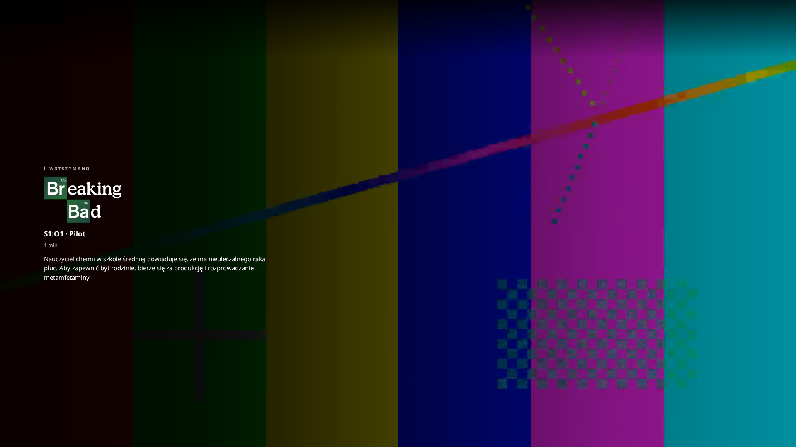
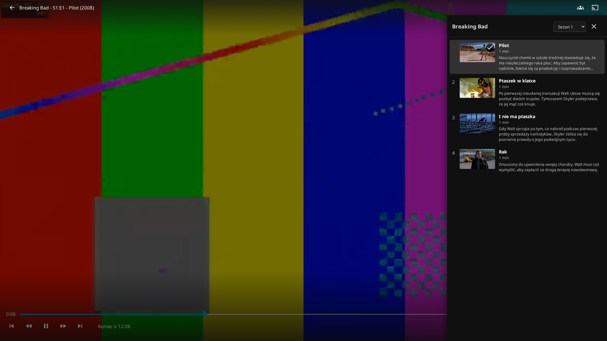
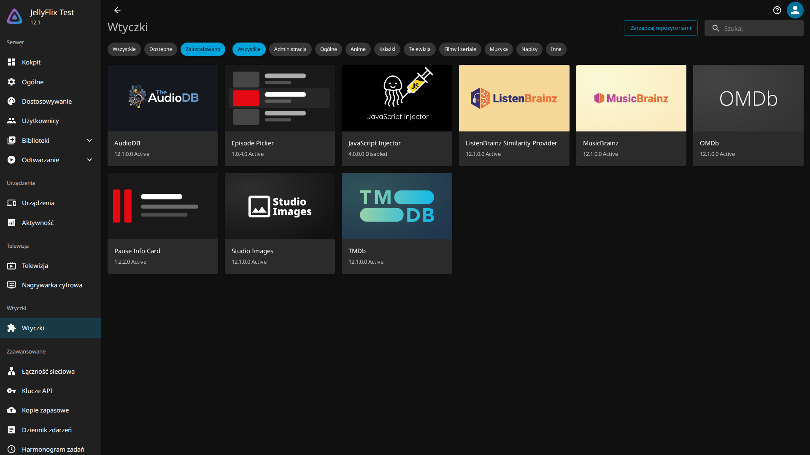

# JellyFlix

***Polski** · [English](README.md)*

Trzy wtyczki do **Jellyfin 12.x**. Dwie przenoszą do klienta webowego kilka zachowań znanych
z Netfliksa; trzecia robi z Filmwebu źródło metadanych. Instalujesz je z katalogu wtyczek samego
Jellyfina — nic nie trzeba nigdzie wklejać ani podmieniać na serwerze.

| | |
|---|---|
| **Pause Info Card** | Zatrzymujesz odtwarzanie i nad kadrem pojawia się logo filmu lub serialu, tytuł odcinka i opis. |
| **Episode Picker** | Podczas odtwarzania serialu guzik w odtwarzaczu otwiera szufladę z odcinkami bieżącego sezonu i wyborem sezonu. Kliknięcie odcinka go włącza. |
| **Filmweb** | [Filmweb.pl](https://www.filmweb.pl) jako źródło metadanych filmów i seriali: polskie tytuły i opisy, gatunki, ocena użytkowników i krytyków, obsada, plakaty. Z wyszukiwaniem w oknie „Identyfikuj”. |





## Wymagania

* **Jellyfin 12.0 albo 12.1** (ABI wtyczek `12.0.0.0`). Budowane i sprawdzane na `jellyfin/jellyfin:12.1`.
* Przeglądarka albo **Jellyfin Desktop 1.11 lub nowszy** — od tej wersji ładuje klienta webowego
  z serwera, więc wtyczki do niego docierają. Starsze renderują kopię wbudowaną w aplikację, do
  której żadna wtyczka serwerowa nie sięgnie.
* Klienty natywne (Jellyfin dla **Android TV**, Kodi, Infuse) nie uruchamiają żadnego kodu webowego —
  nie ma tam `index.html` do wstrzyknięcia ani CSS-a — więc nic stąd do nich nie dotrze. Na pudełku
  z Android TV jest obejście: patrz [Android TV](#android-tv).
* **Filmweb** jest wyjątkiem od dwóch ostatnich punktów: działa w całości na serwerze, więc to, co
  pobierze, widać w każdym kliencie, także natywnym. Serwer musi mieć dostęp do `www.filmweb.pl`.

## Instalacja

1. Kokpit → Wtyczki → **Repozytoria** → **+**, dodaj:

   ```
   https://raw.githubusercontent.com/TerminatorXL/JellyFlix/main/manifest.json
   ```

2. Katalog → zainstaluj **Pause Info Card**, **Episode Picker**, **Filmweb** albo dowolny ich zestaw.
3. **Zrestartuj serwer.** Jellyfin nie ładuje wtyczki bez restartu — do tego czasu wszystko wygląda
   na zainstalowane i nic nie działa.
4. Kokpit → Wtyczki → nazwa wtyczki, żeby wejść w jej ustawienia.

Są od siebie niezależne: możesz zainstalować jedną albo wszystkie trzy. Filmweb wymaga jeszcze
jednego kroku, zanim cokolwiek zrobi — patrz [Filmweb](#filmweb).



## Filmweb

Trzecia wtyczka w ogóle nie dotyczy klienta webowego: robi z [Filmweb.pl](https://www.filmweb.pl)
źródło metadanych, obok TMDb i OMDb. Sama instalacja nie wystarczy, bo Jellyfin pyta o źródła osobno
dla każdej biblioteki:

1. Kokpit → Biblioteki → edycja biblioteki, zaznacz **Filmweb** wśród dostawców metadanych (dla
   filmów albo seriali) i wśród dostawców obrazów.
2. Przeciągnij go nad pozostałe, jeśli ma wygrywać. Jellyfin wypełnia każde pole z pierwszego źródła,
   które je ma, więc Filmweb na górze to polskie tytuły, opisy i gatunki oraz ocena z Filmwebu; niżej
   uzupełnia tylko to, co inni zostawili puste.
3. **Odśwież metadane** biblioteki albo użyj **Identyfikuj** na pojedynczym tytule. W „Identyfikuj”
   pole *Filmweb* przyjmuje identyfikator tytułu albo wklejony w całości adres jego strony.

Co przynosi: tytuł polski i oryginalny, opis, gatunki, kraje produkcji, datę premiery, średnią
użytkowników jako ocenę społeczności i średnią krytyków jako ocenę krytyków, reżyserów i obsadę ze
zdjęciami, polski plakat i kadry oraz link do strony tytułu.

Co warto wiedzieć, zanim puścisz ją na całą bibliotekę:

* **Dopasowanie jest celowo ostrożne.** Wyszukiwarka Filmwebu zawsze coś zwraca, więc skan bez
  nadzoru przyjmuje tylko trafienie ze zgodnym rokiem (plus minus jeden) — a dla folderu bez roku
  w nazwie tylko takie, którego tytuł jest dokładnie ten sam. Reszta zostaje nietknięta, zamiast
  dostać opis innego filmu; od tego jest „Identyfikuj”.
* **Bez nazw postaci.** Filmweb nie udostępnia, kto kogo grał, więc aktorzy przychodzą bez ról.
  Jellyfin bierze osoby z pierwszego źródła, które jakieś ma: jeśli Filmweb jest pierwszy, a chcesz
  obsadę z rolami z TMDb, wyłącz *Directors and cast* w ustawieniach wtyczki.
* **Bez sezonów i odcinków.** Tylko filmy i seriale; reszta zostaje przy tym, co wypełnia ją teraz.
* **Kadry mają najwyżej 900 px szerokości**, mniej niż domyślne minimum Jellyfina dla tła. Są
  dostępne w wyborze obrazów, ale same się nie pobiorą, dopóki nie obniżysz tego minimum.
* **API jest nieoficjalne.** To to samo, z którego korzysta strona Filmwebu, opisane przez
  [filmweb-api](https://github.com/b44x/filmweb-api) — klient w tej wtyczce jest jego portem. Nie ma
  klucza ani gwarancji, że się nie zmieni. Wtyczka pamięta odpowiedzi przez godzinę, wysyła najwyżej
  cztery zapytania naraz i zwalnia, gdy serwer o to prosi.

## Android TV

Aplikacja **Jellyfin dla Android TV** to natywny Kotlin z własnym interfejsem. Nie ładuje żadnego
klienta webowego, więc nie dosięgnie jej żadna wtyczka serwerowa — ani te, ani Custom CSS. To kwestia
architektury, nie luka do załatania.

Obejście istnieje, bo **Jellyfin dla Androida** — aplikacja *mobilna* — jest wrapperem WebView, który
ładuje klienta webowego z Twojego serwera. Zainstalowana na pudełku uruchamia dokładnie ten sam kod co
przeglądarka, razem z wtyczkami.

1. Zainstaluj (sideload) **Jellyfin dla Androida** — wersję mobilną, nie tę dla Android TV.
2. W jej ustawieniach: **Video player → Video player type → Web player**. To jest warunek konieczny:
   *Integrated player* oddaje odtwarzanie ExoPlayerowi i wychodzi z klienta webowego, więc OSD, do
   którego podpinają się wtyczki, w ogóle się nie pojawia.
3. W Jellyfinie: **Ustawienia → Wyświetlanie → Układ → TV**, żeby klient ułożył się pod pilota.

Wtedy pilot działa tak, jak powinien: picker otwiera się guzikiem w odtwarzaczu, góra/dół chodzi po
liście odcinków, lewo/prawo zmienia sezon na selektorze bez przewijania filmu, Enter włącza odcinek,
Back zamyka.

Sprawdzone przez `tools/tv-remote-check.mjs --profile android-webview` — układ TV pod user agentem
Android WebView, sterowany samą klawiaturą, czyli tak blisko, jak da się bez tego pudełka na biurku.
Odtwarzanie w WebView to nie ExoPlayer, więc licz się z obsługą kodeków na poziomie przeglądarki, a nie
aplikacji natywnej; to cena za to, żeby wtyczki w ogóle tam były.

## Ustawienia

Każda wtyczka ma własną stronę w Kokpicie. Zapis działa od następnego przeładowania strony — bez
restartu.

**Pause Info Card** — jak długo ma trwać pauza, zanim pojawi się karta (domyślnie 350 ms; krótsza
pauza to prawie zawsze przewijanie), czy przyciemniać cały kadr, czy używać logo, opisu i ile
zostało do końca. Wozi też trzy haki CSS, które same z siebie nic nie robią, ale pozwalają Twojemu
arkuszowi na więcej: `data-jfx-row` nazywa wiersze na stronie głównej, `--jflix-scroll` publikuje
pozycję przewijania, a `data-jfx-overview`/`-genres`/`-runtime` wstawiają metadane kart do DOM-u.

**Episode Picker** — miniatury, opisy i ich długość.

**Filmweb** — czy nazwą pozycji ma być tytuł polski, czy oryginalny, czy pobierać reżyserów i obsadę
i ilu aktorów, ocenę krytyków oraz kadry jako tła. Zapis działa od następnego odświeżenia metadanych.

To, czego nie ma w Kokpicie, zmienisz per przeglądarka z konsoli — ustawienie jest zapamiętywane:

```js
JellyFlixAddon.setConfig({ pauseInfo: { delayMs: 800 } })
JellyFlixAddon.setConfig({ debug: true })     // logi [JellyFlix] w konsoli
JellyFlixAddon.setConfig(null)                // skasuj zapamiętane zmiany
```

## Motywy

Obie nakładki czytają paletę motywu [Abyss](https://github.com/AumGupta/abyss-jellyfin), jeśli jest
zainstalowany — akcent, szklana tafla, zaokrąglenie i krzywa animacji pochodzą z jego zmiennych
`--abyss-*`, więc szuflada wygląda jak reszta tego motywu, a nie jak coś doklejonego z zewnątrz. Każda
z nich ma jako zapas własną wartość wtyczki, więc bez Abyssa nic się nie zmienia. Wyjątkiem jest
mrożone tło: włącza się **tylko** wtedy, gdy Abyss zdefiniuje rozmycie — jest kosztowne na
telewizorze i nikt nie powinien za nie płacić, jeśli sam się na nie nie zdecydował.

Ustaw własny akcent, a szuflada za nim pójdzie — Abyss przyjmuje go jako R, G, B:

```css
:root { --abyss-accent: 229, 9, 20; }
```

Poza tym to zwykły Custom CSS: arkusze wtyczek są wstrzykiwane jako **pierwsze** dziecko `<head>`,
czyli są najsłabszym arkuszem na stronie — więc każda Twoja reguła `.jfx-pause*` czy `.jfx-eps*`
wygrywa przy równej specyficzności.

## Kiedy nic się nie pokazuje

Każda wtyczka odpowiada pod adresem statusu, który mówi, czy wstrzykuje swój skrypt, a jeśli nie — dlaczego:

```
https://twoj-serwer/PauseInfoCard/status
https://twoj-serwer/EpisodePicker/status
```

```json
{"plugin":"Pause Info Card","version":"1.2.2.0","enabled":true,
 "indexRequestsSeen":1,"injected":1,"lastOutcome":"injected"}
```

* **404** — wtyczka nie działa. Prawie zawsze serwer niezrestartowany po instalacji.
* **`injected: 0`** — widzi stronę i świadomie jej nie tyka; `lastOutcome` napisze dlaczego.
* **`injected` większe od zera, a na ekranie nic** — strona serwera jest w porządku; włącz
  *Console logging* w ustawieniach wtyczki i poszukaj linii `[JellyFlix]` w konsoli przeglądarki.

**Filmweb** niczego nie wstrzykuje, więc nie ma adresu statusu. Gdy tytuł nic od niego nie dostaje:
sprawdź, czy Filmweb jest zaznaczony dla tej biblioteki i tego rodzaju pozycji; uruchom „Identyfikuj”
na tytule, żeby zobaczyć, co zwraca wyszukiwanie; zajrzyj do logu serwera, w którym każda
nieodczytana odpowiedź ma linię `Filmweb:`.

## Jak to działa

jellyfin-web 12.1 **nie ma żadnego haka na własny JavaScript** — Kokpit przyjmuje wyłącznie Custom
CSS. Dlatego każda z dwóch wtyczek klienta webowego jest prawdziwą wtyczką Jellyfina i robi dwie rzeczy:

* `IStartupFilter`, którego middleware dokleja jeden tag `<script>` do `index.html` w locie. Nic nie
  jest zmieniane na dysku, więc aktualizacja serwera tego nie cofnie, a tylko-do-odczytu web root
  w obrazie Dockera nie przeszkadza;
* kontroler API, który serwuje ten skrypt wraz z ustawieniami z Kokpitu.

Obie wtyczki wożą ten sam rdzeń JavaScriptu. Ta, która załaduje się druga, wykrywa pierwszą
i rejestruje wyłącznie własne moduły, zamiast ją zastępować — dzięki temu mogą działać razem na
jednej stronie.

Nie ma telemetrii i te dwie niczego nigdzie nie wysyłają. Każde żądanie idzie do Twojego Jellyfina,
do którego i tak jesteś zalogowany, z tokenem, który klient webowy już ma. Wszystkie są odczytem poza
jednym: wybranie odcinka wysyła POST z poleceniem odtwarzania do Twojej własnej sesji, bo to jedyna
droga, którą wstrzyknięty skrypt może uruchomić odtwarzanie.

**Filmweb** to wtyczka zwykłego rodzaju — dostawcy metadanych i obrazów plus mały klient REST API
pod spodem — i to ona jedna rozmawia ze światem. Serwer pyta `www.filmweb.pl` o tytuły, których
szuka, czyli zdradza Filmwebowi ich nazwy tak samo, jak skan zdradza je już TMDb, a plakaty
i zdjęcia pobiera z CDN-u Filmwebu, `fwcdn.pl`. W oknie „Identyfikuj” miniatury plakatów ładuje
z tego CDN-u bezpośrednio Twoja przeglądarka.

## Budowanie u siebie

Node i Docker, nic więcej nie musi być zainstalowane. Jellyfin 12.1 celuje w **net10.0**, nowszy niż
SDK na większości maszyn, więc C# kompiluje się w oficjalnym kontenerze.

```bash
npm run build:bundles                              # JavaScript, osobny bundel na wtyczkę
npm run build:plugin -- --plugin pause-info-card --version 1.2.2.0
npm run build:plugin -- --plugin episode-picker  --version 1.0.4.0
npm run build:plugin -- --plugin filmweb         --version 1.0.0.0   # sam C#, bez bundla
```

Każdy build zapisuje `dist/plugin/<slug>_<wersja>.zip` i odświeża `manifest.json` o adres źródłowy
i jego MD5, więc adres repozytorium działa od razu po pushu.

Dodanie kolejnej wtyczki to dodanie katalogu w `plugins/` z plikiem `plugin.json` obok projektu C# —
skrypt budujący i manifest obsługują dowolną ich liczbę.

### Testy

Sterują prawdziwą przeglądarką po prawdziwym Jellyfinie, przez kontener Playwrighta:

```bash
tools/pw.sh tools/addon-check.mjs --server    # karta pauzy, tak jak dostarcza ją serwer
tools/pw.sh tools/picker-check.mjs            # szuflada: sezony, odcinki, przełączanie odcinka
tools/pw.sh tools/coexist-check.mjs           # obie wtyczki zainstalowane naraz
```

Filmweb to C# bez przeglądarki, więc sprawdza się go inaczej — testami jednostkowymi na
odpowiedziach zapisanych z API i jednym skryptem, który idzie przez prawdziwego Jellyfina do żywego
API:

```bash
npm run test:plugin                           # testy jednostkowe, w kontenerze .NET SDK
tools/pw.sh tools/filmweb-check.mjs           # „Identyfikuj” przez serwer, na żywym Filmwebie
tools/pw.sh tools/filmweb-check.mjs --apply   # …i prawdziwa identyfikacja jednego filmu i serialu
```

## Bez wtyczek

`dist/jellyflix-addon.user.js` to ten sam kod w jednym pliku pod menedżer userscriptów
(Tampermonkey, Violentmonkey) — per przeglądarka, bez zmian na serwerze. `addons/README.md` to
dokumentacja dla programisty: kontrakt modułu, co daje rdzeń i uzasadnienia tych fragmentów, które
wyglądają dziwnie.

## Licencja

MIT. Niezależny projekt inspirowany zachowaniem Netfliksa; nie zawiera jego logo, czcionek ani
grafik i nie jest z nim powiązany. Z Filmwebem również nie: to, co pobiera wtyczka Filmweb, pochodzi
z Filmweb.pl i należy do jego właścicieli.
